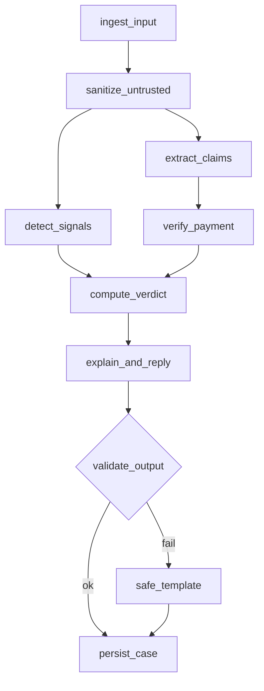
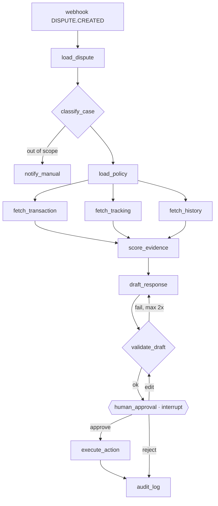

# Vendor Guard

Built for the PayPal AI Hackathon (deadline 12 Nov 2026, 20:00 Lisbon, PayPal Sandbox only).

Two [LangGraph](https://langchain-ai.github.io/langgraph/) graphs on FastAPI, deployed on Render, that protect a PayPal seller:

1. **`scam_check`: before shipping.** The seller pastes a buyer's chat, email or screenshot. Vendor Guard checks the claimed payment against PayPal and returns a verdict: ship, wait, or don't ship.
2. **`dispute_defense`: after shipping.** A `CUSTOMER.DISPUTE.CREATED` webhook starts a graph that gathers evidence, drafts a response and **stops for the seller's approval** before anything is sent to PayPal.

PayPal is the source of truth in both graphs, and nothing that moves money happens without the seller approving it.

> **Status: week 2 of 4 (`scam_check`).** Webhook intake works end to end. The `scam_check` graph and `POST /scam-check` are built and tested, with PayPal and the LLM mocked. Seller authentication and authorization are in progress. `dispute_defense` and the board UI are still to build. See [CHANGES.md](CHANGES.md) for what is done and [RECHECK.md](RECHECK.md) for open code-review points.

| Area | Status |
|---|---|
| Webhook intake: signature check and dedupe (`/webhooks/paypal`) | Done (tests U11, U12, S07) |
| Postgres storage, Render blueprint | Done (`render.yaml` written) |
| Seller authentication, single-use approval tokens | In progress |
| `scam_check` graph and `POST /scam-check` | Done (U01–U05, U09–U10, U17–U20, N01–N04, S01–S06). Paste page and screenshots planned |
| `dispute_defense` graph, approval screen, Bryntum board | Planned, 1–7 Nov |
| Evaluation set, published numbers, demo video | Planned, 8–12 Nov |

## Trust boundaries

Everything that comes from the buyer (chat, email, screenshot, dispute messages) is **untrusted data**. The LLM has **no credentials and no tools**. Only the `execute_action` node writes to PayPal, and only after the seller approves.

```
Seller UI ──► FastAPI (Render) ──► LangGraph ──► PayPal REST APIs
 paste chat     /scam-check            │           payments, transaction search,
 approve        /disputes/{id}/decision├──► LLM     disputes, tracking,
                /webhooks/paypal       │   (structured output, no tools)
 PayPal ──────► verify → dedupe        └──► Postgres
 Sandbox         DISPUTE.* CAPTURE.*        checkpoints · evidence vault · audit_log
                                     Cron job: deadline_watch, hourly
```

## Graph 1: `scam_check`



`extract_claims` takes up to three 17-character transaction IDs from the chat, using a regex and no LLM. `verify_payment` tries each one against the capture API (`GET /v2/payments/captures/{id}`), then Transaction Search (which can lag by hours).

The webhook-fed ledger is not consulted yet. Stored bodies are only CRC32-bound (RECHECK #2), and refund events don't carry the capture ID, so a ledger hit could approve a refunded or forged payment.

A PayPal 403, 429, 5xx, timeout or token failure counts as "unavailable", never as "not found". The amount is compared only to the seller's `expected_amount` and `expected_currency`, never to what the buyer claims.

`compute_verdict` is a pure function with no LLM, and it is the only node that writes `state.verdict`.

| Payment (API) | Signals | Verdict | Message to seller |
|---|---|---|---|
| Found, `COMPLETED`, amount matches | none (checked) | `VERIFIED` | You can ship. Ship only to the address on this payment's Transaction Details page in PayPal. |
| Found, `COMPLETED`, amount matches | any, or the check failed | `VERIFIED_WITH_WARNINGS` | Real payment. Ship only to the address on its Transaction Details page in PayPal, and don't refund differences outside PayPal. |
| Found, `DECLINED`, `FAILED`, `REFUNDED`, `PARTIALLY_REFUNDED` or `REVERSED` | any | `WAIT` | Don't ship. This payment was declined, failed or refunded. |
| Found, `PENDING`, or amount differs | any | `WAIT` | Don't ship yet. |
| Not found | ≥ 2 confirmed | `SCAM_LIKELY` | Don't ship the item unless the payment shows as Completed in your PayPal Activity. |
| Not found otherwise, API unavailable, or no ID in the chat | any | `WAIT` | Not confirmed. Check your PayPal Activity for this payment before you ship. |

The table is applied top-down. When the chat asks the seller to send money, pay a fee or follow a payment link, the message also says: "Never send money, pay a fee or enter card details to receive a payment."

"Not found" alone never means scam. PayPal gives the buyer and the seller different transaction IDs for the same payment ([PayPal Help](https://www.paypal.com/us/cshelp/article/why-are-there-different-buyer-and-seller-transaction-ids-for-the-same-transaction-ts2265)), so the ID a genuine buyer quotes is often unknown to the capture API, and Transaction Search can lag. Activity search in PayPal does find the buyer's ID.

`detect_signals` looks for nine closed patterns: overpayment refund, fake payment proof, money held until tracking, third-party shipping, upfront fee, urgency, moving off-platform, unprotected payment (Friends and Family, gift cards, MB WAY requests) and payment links.

Each hit carries the buyer's exact words. A hit is *confirmed* only when those words are really in the chat, compared on letters and digits only (casefold, unaccented). An unconfirmed hit still blocks `VERIFIED` but never counts toward `SCAM_LIKELY`.

## Graph 2: `dispute_defense`



- `thread_id` is the dispute id. The graph can wait days for the seller and resume from its Postgres checkpoint.
- Reason codes map fixed: `MERCHANDISE_OR_SERVICE_NOT_RECEIVED` → INR, `..._NOT_AS_DESCRIBED` → SNAD, `UNAUTHORISED` → UNAUTH. Anything else goes to `notify_manual`.
- `score_evidence` for INR (0–100): verifiable delivered tracking 40, address matches the transaction details page 25, tracking linked to the transaction 15, shipped before the dispute 10, conversation saved 10. At 70 or above it recommends contesting. For SNAD it marks `seller_protection=false`.
- `human_approval` uses `interrupt()` and issues a single-use approval token bound to the draft's hash. `execute_action` checks the token and the dispute's HATEOAS link, then calls `provide-evidence`, `make-offer` or `accept-claim` with a `PayPal-Request-Id` so a retry never double-sends.

## How hallucinations are prevented

The LLM chooses the words and the code supplies the facts.

1. **Closed context.** Each call sees only this case's evidence and the one `policy_pack` entry chosen by `load_policy`. No web search, no other cases.
2. **Sentences with sources.** Output is a list of `Sentence` (closed `intent`, at least one source: `E…` for evidence, `P.…` for policy).
3. **Facts by placeholder.** The model writes `{{E2.delivered_at}}`, never a date. The code fills in the real value, and policy text is inserted verbatim by `policy_id`.
4. **Deterministic validation.** Every source must exist, every placeholder must belong to a cited source, and no numbers, dates, emails, URLs or phone numbers may appear outside placeholders. Banned phrases ("guaranteed", "you will win", legal or tax advice, other platforms) are rejected.
5. **Abstaining is valid.** Missing proof goes in `missing` with an `ADMIT_MISSING` sentence. Inventing it is a failure.
6. **Safe fallback.** Two failures in a row fall back to a fixed template per verdict or reason, with no LLM, and the case is flagged for review.

Fields in the LangGraph state are owned by the node that writes them (an `@owns(...)` decorator), so an LLM node cannot write the verdict.

`policy_pack.yaml` holds one entry per PayPal rule, looked up by key and never by similarity. Each entry needs `source_url`, `retrieved_at` and `verified: true` before it is used (CI fails otherwise, test U16). Seller Protection depends on region, and for the demo it assumes a US sandbox business account. It does not cover "Significantly Not as Described", so the agent never promises protection on a SNAD dispute.

## Interface (planned)

- **Dispute board** in Bryntum Scheduler: one row per open dispute, colored by graph state, with a diamond at `seller_response_due_date`. The agent adds an "approve by" block 48 h before the deadline, and `deadline_watch` turns anything under 24 h red. Board events are written by code from graph state, never by the LLM.
- **Scam checker**: paste a chat or drop a screenshot, get the verdict with cited sentences.
- **Approval screen**: the draft, its evidence with IDs, and three buttons: approve, edit, reject.
- FastAPI serves the pages and `GET /api/board`. Jinja2, HTMX and vanilla JS, no React.

## Endpoints

| Endpoint | Status | Response |
|---|---|---|
| `GET /healthz` | Built | `{"ok": true}` |
| `POST /webhooks/paypal` | Built | `{"status": "stored"}` or `{"status": "duplicate"}`. 400 on invalid JSON or a bad signature. A 5xx if PayPal is unreachable, so PayPal retries. |
| `POST /scam-check` | Built | Body `{text, expected_amount, expected_currency}` (all required; text up to 8 000 chars after sanitising). Returns `{case_id, verdict, message, sentences, evidence, template, signals_checked, persisted}`. 422 on bad input, 503 when two checks are already running. Not authenticated yet (RECHECK #3). |
| `POST /disputes/{id}/decision` | Planned | Approve, edit or reject a draft |
| `GET /api/board` | Planned | Only the authenticated seller's disputes, with no buyer messages or contacts |

### How the webhook endpoint works today

1. The five `PAYPAL-*` signature headers must be present and `PAYPAL-CERT-URL` must be a `paypal.com` API host, otherwise 400 without calling PayPal.
2. The event is sent to PayPal's `verify-webhook-signature` endpoint. Anything but `SUCCESS` is a 400.
3. The event is inserted into `webhook_events` with `ON CONFLICT DO NOTHING`, so a redelivery is acknowledged but processed once.

## Layout

```
app/main.py         FastAPI app, /healthz, /webhooks/paypal, /scam-check
app/paypal.py       signature-header checks, OAuth token cache, verify-webhook-signature, capture and Transaction Search lookups
app/db.py           schema bootstrap, claim_event() (idempotent insert), save_case()
app/scam_check.py   the scam_check graph: @owns, sanitize, the 10 nodes, verdict table, policy texts
app/output_guardrails.py  Sentence model, validate() and render() for LLM-written sentences
app/llm.py          the one Groq call: strict JSON schema, no tools
tests/              pytest + respx (PayPal and Groq are mocked, no database needed)
render.yaml         Render blueprint: web service + free Postgres
```

## Stack

| Layer | Tool | Installed today |
|---|---|---|
| Core | Python 3.12, FastAPI, Uvicorn, httpx, psycopg | yes |
| Core | LangGraph, Pydantic v2, Groq (`openai/gpt-oss-120b`, strict JSON-schema output) | yes |
| Core | `langgraph-checkpoint-postgres`, PyYAML `policy_pack`, a vision model for screenshots | planned |
| PayPal | Sandbox (US test accounts): Payments v2, Transaction Search, Disputes v1, Tracking, `verify-webhook-signature` | webhook verification only |
| Infra | Render (web service, Postgres, cron job), cloudflared or ngrok for local webhooks | blueprint written |
| Interface | Bryntum Scheduler (trial), Jinja2, HTMX, vanilla JS | planned |
| Tests | pytest, respx; pytest-asyncio, RAGAS and promptfoo later | pytest, respx |
| DevSecOps | GitHub Actions, Bandit or Semgrep, pip-audit | planned |
| Observability | Langfuse or LangSmith (optional) | planned |

## Configuration

Copy `.env.example` to `.env` (it is gitignored).

| Variable | Notes |
|---|---|
| `PAYPAL_CLIENT_ID`, `PAYPAL_CLIENT_SECRET` | Sandbox REST app credentials from developer.paypal.com |
| `PAYPAL_WEBHOOK_ID` | ID of the webhook registered in PayPal. It needs a public URL. |
| `PAYPAL_BASE_URL` | Defaults to `https://api-m.sandbox.paypal.com`. Set to `https://api-m.paypal.com` for live, in `.env` and `render.yaml`. |
| `DATABASE_URL` | Postgres connection string. The tables are created on startup. |
| `GROQ_API_KEY` | From console.groq.com. Required: the app does not start without it. The free tier (8K tokens/min) fits about 2 checks a minute. |
| `LLM_MODEL` | Defaults to `openai/gpt-oss-120b`. Must be a Groq model with strict JSON-schema output. |

Set `LANGSMITH_TRACING=true` only while testing with made-up chats: it sends every chat and LLM reply to LangSmith. Never set it on Render or with real cases. For `/scam-check` to find payments by ID, tick "Transaction Search" on the sandbox REST app. A new permission can take up to 9 hours to reach new tokens.

## Run locally

```sh
python -m venv .venv && source .venv/bin/activate
pip install -r requirements-dev.txt
docker run -d -e POSTGRES_PASSWORD=dev -p 5432:5432 postgres   # matches .env.example
uvicorn app.main:app --reload --env-file .env
```

PayPal needs a public URL to deliver webhooks, so use a tunnel (cloudflared or ngrok) and register `https://<tunnel>/webhooks/paypal` in the PayPal dashboard. Events from the webhook simulator do not pass signature verification, so test with real sandbox payments.

## Tests

```sh
pytest              # offline: PayPal and Groq mocked
pytest -m eval -v    # evals: the real Groq model, key from .env, made-up chats only
```

The plan has 61 test cases in six layers, tracked by ID:

| Layer | IDs | What it covers | Where it runs |
|---|---|---|---|
| Unit | U01–U21 | `compute_verdict`, `classify_case`, `score_evidence`, `@owns`, webhook, `execute_action`, `validate_draft` | CI, PayPal mocked |
| Node (mock) | N01–N10 | LLM and API nodes against simulated PayPal errors (429, 503, `ERRDIS…`) | CI |
| Sandbox | G01–G12 | End to end on PayPal Sandbox, including resume after restart | manual scripts |
| Security | S01–S11 | Prompt injection, forged webhooks, token replay, no tools on LLM nodes | pytest + promptfoo |
| Evaluation | E01–E05 | 60 labelled chats, 20 sandbox disputes, 30 injection variants, 50 drafts | scripts + RAGAS |
| Spike | P01–P02 | Which payment source feeds the ledger, and whether simulator events verify | manual |

**Passing today:**

- Webhook: U11 (a failed signature returns 400 and stores nothing), U12 (the same event twice is stored once) and S07 (a forged webhook is rejected before PayPal is called).
- `scam_check`:
  - U01–U05: the verdict table.
  - U09–U10: `@owns`.
  - U17–U20: the output guardrails (tests/test_output_guardrails.py).
  - Evals (`pytest -m eval`): real Groq drafts for 10 verdict paths must pass the output guardrails, and 3 injection chats run through the whole graph must not put buyer text in the reply (tests/test_eval_output_guardrails.py).
  - N01–N04: PayPal 404, 403, 429, 503, timeouts, token failure, Transaction Search rows, LLM and database failures.
  - S01–S06: prompt injection, unverifiable quotes, no tools and no secrets in prompts, no ship wording from the LLM, Unicode and tag tricks.

The tests mock PayPal and Groq and replace the database calls, so they need neither credentials nor Postgres. They do not exercise the real SQL in `db.claim_event` or `db.save_case` (see RECHECK #7). Test IDs follow this README's grouping; there is no separate test-plan document.

## Build order

| Dates | Phase | Covers |
|---|---|---|
| 17–24 Oct | Foundations: FastAPI, Postgres, Render deploy, sandbox OAuth, webhook verification and dedupe | P01–P02, U11–U12 |
| 25–31 Oct | `scam_check`: nodes, verdict policy, paste UI, output guardrails | U01–U05, U09–U10, U17–U20, N01–N04, G01–G03, S01–S06 |
| 1–7 Nov | `dispute_defense`: fan-out, scoring, draft, `interrupt()`, approval screen, verified `policy_pack`, board | U06–U08, U13–U16, U21, N05–N10, G04–G12, S03, S07–S11 |
| 8–12 Nov | Run the evaluation set, publish the numbers, record a real demo | E01–E05 |

## Deploy

`render.yaml` defines the web service and a free Postgres. Set `PAYPAL_CLIENT_ID`, `PAYPAL_CLIENT_SECRET`, `PAYPAL_WEBHOOK_ID` and `GROQ_API_KEY` in the Render dashboard (they are `sync: false`). Dispute creation, `require-evidence` and `adjudicate` exist only in the sandbox. Always check a dispute's HATEOAS links before calling an action.
